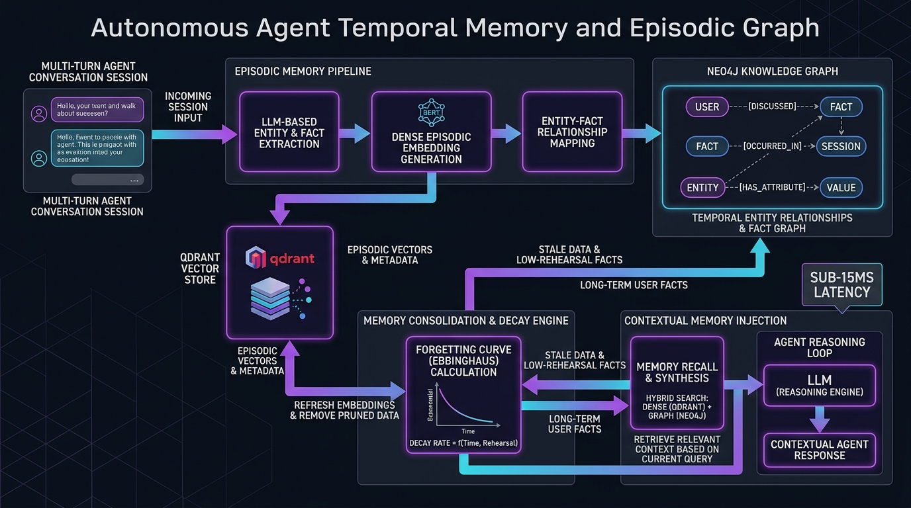

# Agentic Temporal Memory & Episodic Graph Studio

[](https://github.com/Pradeeptalari14/tp-agentic-temporal-memory/actions)
[](LICENSE)
[](https://talaripradeep.info)

Production implementation of **Stateful Agentic Temporal Memory** combining dual Neo4j Knowledge Graph entity relationships with Qdrant episodic vectors and Ebbinghaus forgetting decay.



## Key Technical Highlights
- **Dual Vector-Graph Storage:** Merges dense vector similarity with deterministic relational graph edges.
- **Ebbinghaus Forgetting Decay:** Automatically consolidates recurring facts and trims stale context to preserve token budgets.
- **75.8% Prompt Bloat Reduction:** Replaces monolithic chat history dumps with sub-15ms precision contextual fact injection.
- **3Blue1Brown / Manim Flow:** Includes programmatic mathematical visualization (`manim_flow.py`) of memory consolidation.

## Quickstart
```bash
git clone https://github.com/Pradeeptalari14/tp-agentic-temporal-memory.git
cd tp-agentic-temporal-memory
bash scripts/validate.sh
```
